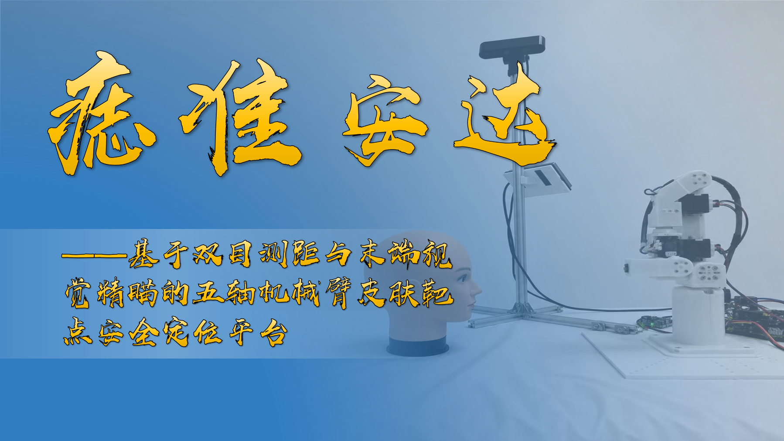
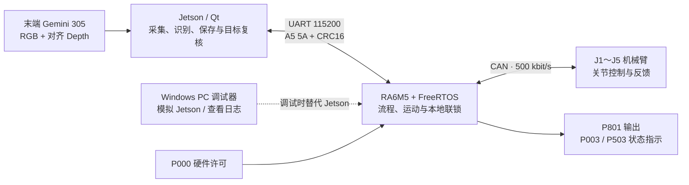
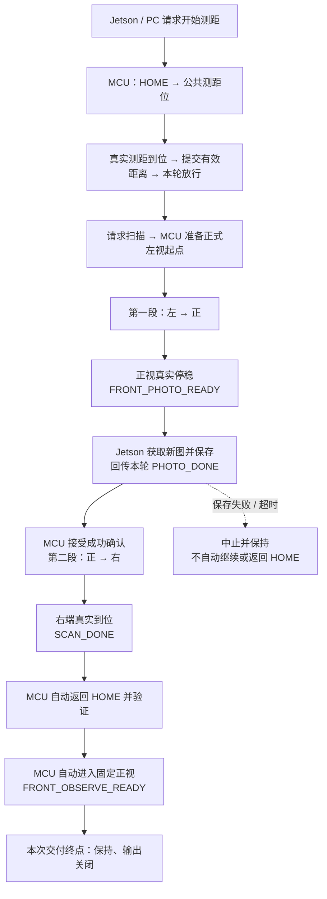
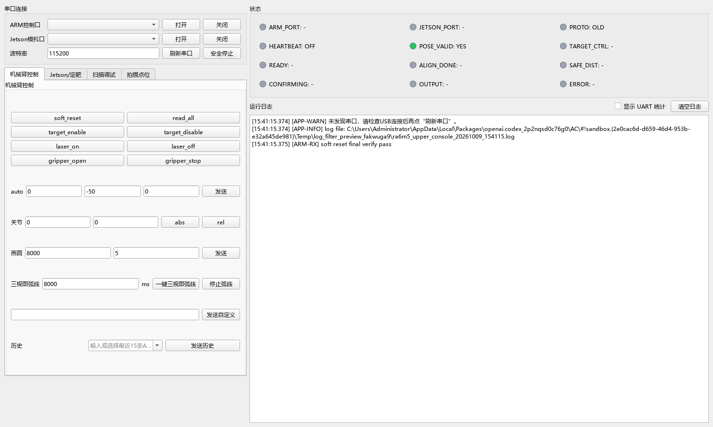

<div align="center">

# 痣准安达

### 基于 Renesas RA6M5 与 FreeRTOS 的五轴机械臂控制系统

固定路线扫描 · 实时视觉对准 · 本地输出联锁 · PC 协议模拟


[快速开始](#快速开始) · [系统架构](#系统架构) · [扫描流程](#扫描流程) · [开发文档](#开发文档)

</div>

## 项目简介

痣准安达是一套面向皮肤靶点定位研究与竞赛演示的机械臂平台：通过末端相机观察人脸模型，由 Jetson 识别目标并提供视觉误差，RA6M5 负责机械臂运动、流程调度和本地输出控制。

本仓库包含 **RA6M5 下位机固件、Windows PC 调试器和联调文档**。Jetson 的相机采集、目标识别、Qt 操作界面与数字人展示程序由另一端维护，不包含在本仓库中。

当前主要改造是把原来的三视图逐点拍摄替换为 **左 → 正、正 → 右两段平滑扫描**：中途正视停稳并等待照片保存确认，右扫结束后由 MCU 自动回 HOME，再进入固定正视观察位。

> 本项目是固定人脸模型上的研究与演示原型，不是临床医疗设备。扫描成功、模型显示成功或像素误差收敛，都不能作为真人治疗安全或定位精度的证明。

<div align="center">
  
  <p><sub>历史台架照片：图中为顶部双目配置；当前视觉方案已调整为机械臂末端单 Gemini 305。</sub></p>
</div>

## 功能与进度

| 模块 | 本仓库提供的能力 | 当前边界 |
| --- | --- | --- |
| 五轴运动控制 | J1～J5 控制、关节反馈、FK / IK、平滑轨迹和 HOME 验证 | J6 作为夹爪，不计入五轴运动；运动学存在不等于相机安装标定完成 |
| 固定扫描 | 正式姿态准备、两段扫描、正视保存等待、自动 HOME → 固定正视 | MCU / PC 链已实现，已有 PC 模拟握手的实机完成记录；真实 Jetson 保存仍需联调 |
| 视觉定靶 | 实时 `dcx / dcy` 误差输入、视觉伺服、稳定对准与失效处理 | 原独立定靶逻辑保留；末端双目方案下仍需实机验证 |
| 通信与流程 | CRC 校验、心跳、SEQ / scan_id 关联、查询、重发与超时处理 | 扫描字节表已冻结；目标绑定、同一颗复核和医生单次许可接口仍待共同冻结与接入 |
| 停止与输出 | 中止保持、停止完成确认、P000 硬件许可、输出时冻结运动 | ACK 不代表停稳或获得输出许可；新扫描链不能直接启用旧打靶入口 |
| PC 调试器 | 双串口、Jetson 协议模拟、扫描页、状态显示、日志与 UART 统计过滤 | 保存成功按钮仅模拟握手，不实际拍照；不是独立于 Qt 的安全控制器 |
| 离线验证 | 协议、状态机、实际 C 运动函数、CAN 反馈与停止确认测试 | 不连接硬件的测试不能替代路径、测距与双端验收 |

**当前交付到最终正视保持。** 扫描后的目标身份绑定、同一颗复核及医生单次许可还没有形成完整执行链，不能将“原定靶代码存在”理解为“新扫描后已可自动执行”。

本轮扫描不生成新的三维人脸，也不要求 Jetson 下发痣的基座 XYZ。数字人展示使用已有模型；后续对准方案仍以当前画面中的同一目标及实时像素误差为基础。

## 系统架构



| 一侧 | 负责什么 | 不负责什么 |
| --- | --- | --- |
| Jetson | RGB-D 采集、照片实际保存、目标识别与身份复核、像素误差、界面展示 | 不能仅凭页面按钮直接控制硬件输出，也不能把旧缓存当作新照片 |
| RA6M5 | 运动执行、真实关节反馈、流程门控、心跳与故障处理、本地输出条件 | 不处理相机图像，不接收人脸网格，不用展示模型坐标规划任意靶点 |
| PC 调试器 | 模拟协议握手、查看状态、保存日志、受控台架验证 | 不提供真实视觉和测距证据，不替代真实 Jetson 联调 |

PC 和真实 Jetson **不能同时占用同一协议口**。ARM 文本调试口与 Jetson 二进制协议口是两条不同通道，串口号以本机枚举结果为准。

### 主要硬件与软件

| 项目 | 当前配置 |
| --- | --- |
| MCU / 工程目标 | Renesas RA6M5，`R7FA6M5BF`，Keil 目标 `Target_1` |
| SDK / 工具链 | Renesas FSP / RA_DFP 6.4.0，工程配置 ARMClang 6.24 |
| 任务调度 | FreeRTOS；运动任务与视觉 / 流程服务分开运行 |
| 电机通信 | CAN 通道 0，标称速率 500 kbit/s，Emm V5 驱动接口 |
| 视觉设备 | 末端 Gemini 305；RGB 与对齐 Depth 为 848 × 530，采集设置 30 FPS |
| PC 软件 | Python 3.11、PySide6、pyserial；PyInstaller 打包 Windows EXE |

相机设置由 Jetson 侧完成。相机内参不等于手眼安装矩阵；本次固定路线扫描不把手眼标定或逐帧相机位姿上传作为前置条件。

## 扫描流程



这里的“弧线扫描”是正式关节配方之间的两段平滑运动，**不是绕头 360°、严格笛卡尔圆弧或恒高扫描**。正视中途有明确的停稳保存环节，不是从左到右不停顿。

需要区分三个通知：

- `FRONT_PHOTO_READY`：中途正视停稳，允许获取并保存新照片。
- `SCAN_DONE` / `HOME_READY`：进度通知，不是最终正视就绪。
- `FRONT_OBSERVE_READY`：本轮自动 HOME → 正视已经完成，进入最终保持。

右扫正常结束后的 HOME → 固定正视由 MCU 自行完成，Jetson 不需要再发送额外 HOME、GOTO 或 SELECT。仅正常成功分支自动推进；故障、取消、保存失败或超时均停止保持。

后续业务目标是“选中具体一颗 → 当前新画面复核同一颗 → 视觉对准 → 医生单次确认及硬件许可 → 执行”，但这部分新链仍待接入，不能通过旧 SELECT / TARGET 命令绕过。

## 快速开始

### 1. 获取仓库

```bash
git clone https://github.com/pzbc1502/Robot_FreeRTOS-Arm.git
cd Robot_FreeRTOS-Arm
```

以下命令均在仓库根目录执行。只阅读文档、运行协议自检或打开 PC 界面，不需要连接机械臂。

### 2. 构建 MCU 固件

1. 安装 Keil MDK、ARM Compiler 6.24 与 `Renesas.RA_DFP.6.4.0`。
2. 打开 [`Robot_FreeRTOS.uvprojx`](Robot_FreeRTOS.uvprojx)，选择 `Target_1`。
3. 检查器件、编译器和调试器配置后执行 Build。
4. 固件产物为 `Objects/Robot_FreeRTOS.axf` 和 `Objects/Robot_FreeRTOS.hex`。

FSP 配置入口为 [`configuration.xml`](configuration.xml)。`ra_gen/`、`ra_cfg/` 为生成文件所在目录，`ra/` 为 SDK；修改外设或引脚时应检查生成结果，避免覆盖应用改动。构建成功不代表板上固件已经更新。

烧录前先断开自动流程、关闭输出，并确认机械臂有可靠支撑及可用的物理急停。不要套用其他芯片的 Flash 地址或未经核对的调试配置。

### 3. 启动 PC 调试器

Windows 可直接运行仓库中的 [`RA6M5_Robot_Console.exe`](UpperComputer/dist/RA6M5_Robot_Console.exe)。从源码运行：

```powershell
py -3.11 -m pip install PySide6 pyserial
py -3.11 UpperComputer/ra6m5_upper_console.py
```

程序启动不会自动打开串口或运动。“ARM控制口”用于文本命令与日志；“Jetson模拟口”用于正式二进制协议，两者默认波特率均为 115200。

<details>
<summary>查看 PC 调试界面</summary>



上图为离线界面记录，不是成功连接设备或完成运动的证明。

</details>

### 4. 先做离线检查

```powershell
py -3.11 UpperComputer/ra6m5_upper_console.py --self-test
py -3.11 DEBUG/test_scan_protocol.py
```

运动、UART、状态机、CAN 反馈和停止确认还有实际 C 函数的本机测试：

```powershell
py -3.11 DEBUG/test_scan_motion.py --gcc "C:\path\to\gcc.exe"
py -3.11 DEBUG/test_can_angle_feedback.py --gcc "C:\path\to\gcc.exe"
py -3.11 DEBUG/test_scan_uart.py
py -3.11 DEBUG/test_scan_workflow.py
py -3.11 DEBUG/test_stop_confirmation.py
```

这些测试使用模拟输入，不发送真实运动指令。C 测试需要可用的本机 GCC：支持 `--gcc` 的脚本可显式指定路径；其余脚本的编译器查找方式见对应文件。测试通过不证明机械路径或 Jetson 保存握手已经验收。

### 5. 受控扫描联调

先确认固定人脸模型、机械臂底座、线缆及工作距离均在已验证范围，运动范围无人，输出关闭，现场有人值守且急停可用。

```text
打开两个正确的串口，选择新协议
    → 扫描调试：开始测距
    → 等公共测距位真实到位
    → 输入现场实测值，提交 3 帧实测距离
    → 等本轮测距放行后启动扫描
    → 等正视拍照就绪，点击保存成功（模拟）
    → 等 MCU 自动右扫 → HOME → 固定正视
    → 核对最终到位通知
```

PC 的距离按钮重复同一输入值用于台架握手验证，不是三个独立深度样本；保存按钮不实际获取图像。真实 Jetson 必须使用到位后的新深度、新照片与实际保存结果。异常使用“终止并保持”，不能把控制 ACK 当作停止完成。

打包 EXE 的完整环境处理和命令见 [PC 上位机说明](UpperComputer/README.md)。

## 通信约定

正式协议采用 UART `115200 / 8N1`，帧格式为：

```text
A5 5A | VER | TYPE | SEQ | LEN | PAYLOAD[LEN] | CRC16_LO CRC16_HI
```

- 当前 `VER=0x01`，扫描合同为 `SCAN_WIRE_20261009`；版本字节相同不代表新旧业务兼容。
- CRC16/MODBUS 从 `VER` 计算至 payload 末尾，低字节先发送。
- `SCAN_CTRL=0x07 / LEN=6`，`SCAN_STATUS=0x82 / LEN=10`。
- 扫描控制与状态关联本轮 `scan_id`；重发保留相同请求字节、SEQ 和 ID。
- ACK 仅表示命令接受，不能替代真实到位、照片保存或停止完成。
- `error=0x10` 已冻结为 `SCAN_ID_MISMATCH`，不能按旧端定义解读为安全测距超时。

线上编号、字段偏移、状态及错误含义以 [通信协议](doc/Jetson↔RA6M5%20通信协议.md) 和 [`Middle/jetson_vision.h`](Middle/jetson_vision.h) 为依据；尚未冻结的目标和医生许可接口不能自拟字节发送。

## 安全与验证边界

| 项目 | 当前设置或要求 |
| --- | --- |
| 测距门槛 | MCU 当前阈值为 100 mm，原稳定样本规则保留；一次测距放行不证明全路径安全 |
| 心跳 | MCU 超时为 600 ms；PC 正式流程默认每 200 ms 发送 |
| 视觉新鲜度 | 原定靶视觉有效期为 500 ms；无效、丢失或过期不能沿用旧误差 |
| 输出许可 | 原定靶使用 P000 物理按键与其他本地条件；上位机不能模拟绕过 |
| 输出上限 | 原固件单次硬上限为 10 s，不是默认执行时长或治疗参数 |
| 关节限位开关 | 当前台架没有实体关节限位开关，`ROBOT_JOINT_LIMIT_SWITCHES_ENABLED=0`；不能声称已具备硬件限位保护 |
| 扫描测距 | 本批未新增扫描阶段持续测距保护，采用固定模型与已验证路径的受控演示 |
| 异常停止 | 停止并保持，不自动 HOME；停止未确认时不能声称机械臂已停稳 |

CAN 新反馈缺失、跟踪误差或运动失败仍会中止扫描，不用缓存角度伪造到位。已有实机成功记录不等于稳定性验收：仍需检查间歇性反馈超时、真实 Jetson 保存应答，以及多轮路径与异常停止。

独立于 Qt 的 Jetson 失效停止任务也需要对端实现与验收。PC 界面互锁不能约束其他串口终端、MQTT 控制端或独立调试器；调试器暂停 MCU 时，不应依赖固件继续保护。

## 仓库导航

```text
Robot_FreeRTOS-Arm/
├── APP/                  机械臂、采集、定靶、流程与底盘应用
├── Middle/               运动学、Jetson 协议及其他中间层
├── USER_BSP/             CAN、UART、USB、输出与电机驱动封装
├── src/                  FreeRTOS 线程入口与板级启动
├── ra/                   Renesas FSP、FreeRTOS 与 SDK 依赖
├── ra_cfg/               FSP 生成配置
├── ra_gen/               FSP 生成外设及线程代码
├── UpperComputer/        Python PC 调试器与打包 EXE
├── DEBUG/                离线测试、协议模拟与诊断资料
├── doc/                  当前流程、固件与协议文档
├── 文档/                 竞赛材料、历史报告与图片
├── configuration.xml     FSP 配置入口
└── Robot_FreeRTOS.uvprojx Keil 工程入口
```

阅读代码可从三个入口开始：

- [`src/robot_thread_entry.c`](src/robot_thread_entry.c)：板级驱动和机械臂初始化。
- [`src/vision_service_thread_entry.c`](src/vision_service_thread_entry.c)：协议接收、观测组装与流程推进。
- [`APP/robot_workflow.c`](APP/robot_workflow.c)：测距、扫描、保存等待、返回与故障保持。

## 开发文档

| 文档 | 适合查看的内容 |
| --- | --- |
| [项目演示](doc/项目演示.md) | 当前业务顺序、两端职责，以及明确不做的内容 |
| [固定扫描需求与实施规划](doc/弧线连续扫描需求与实施规划.md) | 两段轨迹、保存握手、实施状态及待验收事项 |
| [Jetson ↔ RA6M5 通信协议](doc/Jetson↔RA6M5%20通信协议.md) | 帧格式、冻结扫描字节表、异常处理与待冻结接口 |
| [RA6M5 固件说明](doc/RA6M5%20固件说明.md) | 固件模块、控制接口和历史功能说明 |
| [PC 上位机说明](UpperComputer/README.md) | 双串口、扫描模拟、日志过滤、停止确认与打包 |

旧报告和早期台架可能仍使用“顶部双目 + 末端单目”或“三视图逐点拍摄”的描述。当前扫描方案应结合本文、项目演示文档和实际头文件阅读；发生冲突时先核对代码与双方冻结的接口，不根据历史图示发送控制命令。

## 协作与问题反馈

建议通过 [GitHub Issues](https://github.com/pzbc1502/Robot_FreeRTOS-Arm/issues) 提交问题，附上固件提交号、PC / Jetson 版本、串口日志、所处流程阶段和复现条件。涉及运动的异常，请说明是否使用固定模型及停止是否得到确认，不先反复重启来掩盖问题。

修改建议按运动层、业务状态机、通信或 PC 界面分别提交，先运行相关离线检查，再做受控实机验证。调整相机安装、点位、方向、视觉参考、工作距离或许可规则后，应重新验证对应流程。

仓库中的 Renesas FSP、FreeRTOS、CMSIS 等第三方组件保留各自许可证与版权声明；本 README 不替项目新增许可证或改变原有授权。
